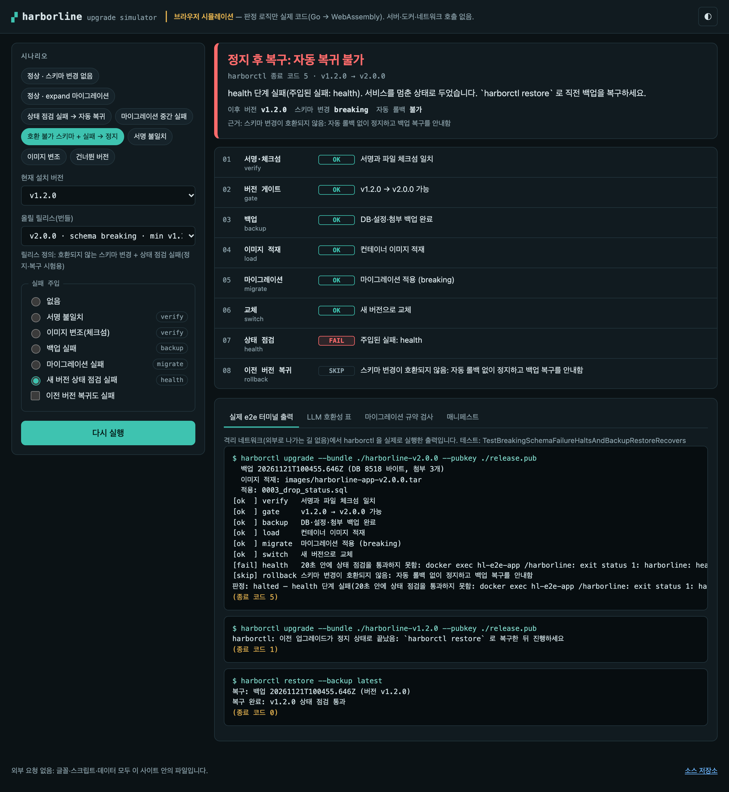
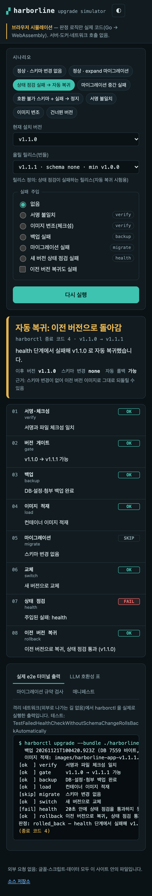
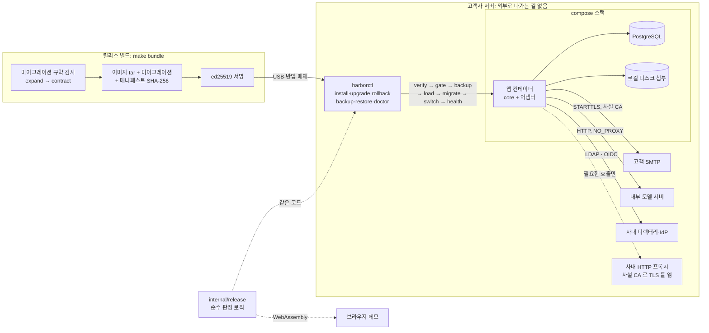

# Harborline

**라이브 데모: https://choibongseok.github.io/harborline/**





클라우드로만 돌던 작은 서비스(문의함)를 **인터넷이 없는 고객사 서버에 설치형으로 내는 방법**을 직접 만들어 본 저장소입니다. 본체는 문의 접수·답변·메일 알림·첨부·답변 초안 제안만 하는 작은 서비스이고, 다루는 주제는 본체가 아니라 이 네 가지입니다.

1. 외부 서비스 의존성(파일 저장소, 메일, 인증, LLM)을 고객 환경의 대체물로 바꾸는 **어댑터**와 폐쇄망 동작
2. 오프라인 **번들**(이미지 tar·마이그레이션·서명된 매니페스트)과 `harborctl` 의 설치·업그레이드·롤백·백업·복구·사전 점검
3. 사내 HTTP 프록시·사설 CA·SMTP(STARTTLS)·LDAP·OIDC 같은 **엔터프라이즈 연동**
4. 고객사 내부 OpenAI 호환 엔드포인트에 붙는 LLM 어댑터와 **호환성 검증**

데모 사이트는 **브라우저 안에서 도는 시뮬레이션**입니다. 서버·도커에 연결되어 있지 않고, 업그레이드 판정(매니페스트 게이트, 자동 복귀/정지 결정)과 마이그레이션 규약 검사만 `internal/release` 의 Go 코드를 **WebAssembly 로 컴파일해 그대로** 실행합니다(규칙을 JS 로 다시 쓰지 않았습니다). 옆에 실린 터미널 출력과 LLM 호환성 표는 이 저장소의 e2e·호환성 검증을 실제로 실행해서 나온 파일입니다. 사이트는 외부 요청을 하지 않습니다(글꼴·스크립트·데이터 모두 같은 경로의 정적 파일).

## 구조



| 경로 | 맡은 일 |
|---|---|
| `internal/release` | 매니페스트 게이트, 서명·체크섬 검증, 업그레이드 상태 기계(자동 복귀/정지 결정), 마이그레이션 규약 검사. 파일·도커를 만지지 않는 순수 패키지 |
| `internal/ctl`, `cmd/harborctl` | 위 상태 기계의 실행기(docker compose, 백업·복구, doctor) |
| `cmd/hlbuild` | 규약 검사 → 이미지 빌드 → `docker save` → 매니페스트 → 서명. 규약 위반이면 번들을 만들지 않는다 |
| `internal/app`, `internal/adapters/*`, `internal/llm` | 서비스 코어와 어댑터(저장소·메일·인증·LLM) |
| `internal/wiring` | 설정(프로필)에서 어댑터를 고르는 유일한 자리 |
| `internal/sim`, `cmd/wasm`, `web/` | 브라우저 시뮬레이션 |
| `cmd/hltools` | 시험용 고객 환경 모의(내부 모델 서버, SMTP, 싱크홀, 프록시, 게이트웨이) |
| `migrations/`, `releases/` | 스키마 변경 파일과 릴리스 정의(예제 릴리스 9종, 일부러 깨진 것 포함) |

## 5분 실행

필요한 것: Go 1.25, Docker(compose 플러그인 포함), Node 24(데모 사이트 시험에만).

```bash
make up                              # 번들 빌드 → 격리 네트워크 + 고객 사이트 모의 → harborctl 로 v1.0.0 설치
curl -s http://127.0.0.1:58181/api/system
bash scripts/demo.sh upgrade v1.1.0  # 업그레이드(서명·체크섬 검증, 백업, 상태 점검)
make down                            # 컨테이너·볼륨·설치 폴더 정리
```

`make up` 이 만드는 것: 외부로 나가는 길이 없는 도커 네트워크(`internal: true`), 그 안의 SMTP(STARTTLS, 사설 CA)·내부 모델 서버·외부 접속 기록기, 호스트에서 앱으로 들어오는 유일한 길인 게이트웨이(`127.0.0.1:58181`). 앱·DB 는 `harborctl install` 이 올립니다. 사용하는 호스트 포트는 `58181`(데모), `58180`·`56433`·`53890`·`58480`(시험) 뿐입니다.

## 설계 결정

### 어댑터 경계를 어디에 그었나

코어(`internal/app`)가 아는 외부 의존성은 작은 인터페이스 네 개뿐입니다: `storage.Store`(Put/Get), `mail.Sender`, `auth.Authenticator`(+ 선택적 `PasswordLogin`), `Drafter`. 구현은 둘씩 있습니다.

| 의존성 | 클라우드 | 설치형 |
|---|---|---|
| 첨부 | S3 호환(SigV4 직접 구현) | 로컬 디스크 |
| 메일 | 클라우드 메일 API | 고객 SMTP(STARTTLS, 사설 CA) |
| 인증 | 자체 로그인 | 자체 로그인 · OIDC(그룹 클레임 → 역할) · LDAP(그룹 → 역할) |
| LLM | 호스팅 엔드포인트 | 고객사 내부 OpenAI 호환 엔드포인트 |

프로필(`HARBORLINE_PROFILE=cloud|onprem`)은 설정 한 곳에서 고르고, 어댑터 선택은 `internal/wiring` 한 자리에서만 합니다. **설치형 프로필은 클라우드 어댑터를 설정 검증에서 거부**하므로 S3·메일 API·호스팅 LLM 을 만드는 경로에 들어가지 않습니다. 통합 테스트가 이를 확인합니다: 설치형 프로필로 전체 시나리오(접수·첨부·초안·답변)를 돌리는 동안 나가는 HTTP 목적지는 설정한 내부 모델 서버 하나뿐이고, 같은 코어에 클라우드 프로필을 주면 S3·메일 API·LLM 세 곳으로 나갑니다. e2e 는 이를 한 번 더 네트워크 수준에서 확인합니다(아래 "폐쇄망").

### 폐쇄망 증명

e2e 의 고객 사이트는 `internal: true` 도커 네트워크입니다. 앱의 DNS 를 **싱크홀**(모든 이름을 자기 IP 로 답하고 흔한 포트 접속을 기록하는 서버)로 지정해 두고, 설치부터 업그레이드·롤백·백업 복구까지 전 시나리오를 돌린 뒤 싱크홀 기록이 0건임을 확인합니다. 0건이라는 결과가 의미 있도록 같은 네트워크에서 외부 이름을 조회하는 **대조군**이 싱크홀에 기록되는지를 먼저 시험합니다. 이 네트워크에는 이미지 레지스트리도 없으므로 이미지는 번들의 tar 로만 들어옵니다.

### 스키마 변경과 자동 롤백

업그레이드가 실패했을 때 "이전 버전으로 되돌리면 되는가"는 **스키마가 호환되는가**로 결정됩니다. 매니페스트의 `schema` 가 세 값 중 하나입니다.

| `schema` | 실패 시 |
|---|---|
| `none` | 이전 버전 이미지로 자동 복귀 → **상태 점검을 다시 통과해야** 성공으로 본다 |
| `compatible` | 마이그레이션이 중간에 실패해도 자동 복귀(이전 버전이 확장된 스키마에서 동작함) |
| `breaking` | 자동 복귀하지 않고 정지, 직전 백업 복구를 안내 |

복귀 자체가 실패하거나 신규 설치가 실패한 경우도 정지합니다. 이 결정 전부가 `internal/release` 의 `Upgrade` 한 함수에 있고, harborctl(도커 실행기)과 브라우저 데모(가짜 실행기)가 같은 함수를 부릅니다. 브라우저에서 실패를 주입해 보면 e2e 에서 실제로 일어난 결과와 같은 결정이 나옵니다.

### expand → contract 마이그레이션 규약

스키마 변경을 "확장(구버전과 호환)"과 "정리(다음 릴리스)"로 나누면 스키마가 바뀐 릴리스도 자동 롤백이 됩니다. 예제 `v1.2.0` 은 `status`(text) → `state`(smallint) 이전의 expand 단계입니다: 컬럼을 더하고 백필하고, **구버전 앱이 `status` 에 쓰는 것을 `state` 로 복사하는 트리거**를 둡니다. 통합 테스트가 이전 버전 앱이 확장된 스키마에서 그대로 쓰고, 새 버전이 그 행을 맞게 읽는 것을 확인합니다. 반대로 `status` 를 바로 지우는 `v2.0.0`(`breaking`)은 이전 버전 앱이 쓰기에 실패하는 것도 시험합니다.

규약은 빌드가 검사합니다(`cmd/hlbuild lint`, `make bundle`·`make verify` 가 먼저 돈다). 마이그레이션 파일 머리의 `-- release:`/`-- phase:` 주석으로 expand 는 컬럼 삭제·이름 변경·타입 변경·`SET NOT NULL`·기본값 없는 `NOT NULL` 추가를 할 수 없고, contract 는 앞선 expand 를 `contract-of` 로 가리키며 앞 릴리스가 이미 쓰지 않는 것(`unused-since`)만 지울 수 있습니다. 매니페스트가 선언한 `schema` 가 마이그레이션에서 계산한 값과 다르면 번들이 만들어지지 않습니다. 브라우저 데모의 "마이그레이션 규약 검사" 탭에서 같은 검사기를 직접 돌려 볼 수 있습니다.

### 번들 무결성

번들은 `manifest.json`(버전, 업그레이드 가능한 최소 기존 버전 `min_from`, `schema`, 파일별 SHA-256), `manifest.sig`(ed25519), `images/*.tar`(`docker save`), `migrations/*.sql` 입니다. harborctl 은 **가장 먼저** 서명을 매니페스트 원문 바이트에 대해 검증하고 모든 파일의 체크섬을 대조합니다. 서명이 틀리거나 파일이 한 바이트라도 바뀌면 백업도 만들기 전에 거부합니다(e2e: 신뢰하지 않는 키로 서명한 번들, 이미지 tar 에 1바이트를 덧붙인 번들). 공개키는 번들과 다른 경로로 받아 `--pubkey` 로 줍니다. 건너뛴 버전과 낮은 버전도 같은 단계에서 거부합니다.

### LLM 기능 탐지와 대체 경로

고객사 내부 모델 서버는 기능이 제각각이라 시작할 때 **실제 요청으로** 탐지합니다: 도구 호출(강제 호출을 요청해 `tool_calls` 가 오는지), JSON 모드(`response_format` 을 요청하고 응답 **전체가 JSON 인지** — 요청만 받고 무시하는 서버가 많아 성공 응답만으로는 판단하지 않음), 컨텍스트 길이(단계별 입력으로 시험). 결과에 따라 경로가 정해집니다.

| 기능 | 네이티브 | 대체 | 비활성 |
|---|---|---|---|
| 분류(구조화 출력) | 도구 호출 | JSON 모드 → 프롬프트로 JSON 요구 + 코드 펜스·앞뒤 설명을 견디는 파싱 | 엔드포인트에 닿지 않을 때 |
| 답변 초안 | 한 번에 처리 | 컨텍스트 예산(절반)을 넘으면 마지막 메시지는 그대로 두고 앞부분을 조각별로 요약 | 컨텍스트가 너무 작거나 요약해도 안 들어갈 때 |

엔드포인트가 죽어 있어도 서비스는 뜨고, 초안 API 만 503 입니다(통합 테스트). 호환성 검증기(`make compat`)는 모의 내부 모델 서버의 프로필 5종과 응답 없는 엔드포인트에 같은 시나리오를 돌려 표를 만듭니다.

<!-- compat:begin -->
| 프로필 | 도구 호출 | JSON 모드 | 컨텍스트(토큰) | 분류(구조화 출력) | 답변 초안(짧은 스레드) | 답변 초안(긴 스레드) |
|---|---|---|---|---|---|---|
| full | 지원 | 지원 | 8192 | 통과 (tools) | 통과 (direct) | 통과 (direct) |
| no-tools | 미지원 | 지원 | 8192 | 대체 경로 (json_mode) | 통과 (direct) | 통과 (direct) |
| no-json | 미지원 | 미지원 | 8192 | 대체 경로 (prompt_json) | 통과 (direct) | 통과 (direct) |
| short-ctx | 지원 | 지원 | 1024 | 통과 (tools) | 통과 (direct) | 대체 경로 (chunked) |
| bare | 미지원 | 미지원 | 1024 | 대체 경로 (prompt_json) | 통과 (direct) | 대체 경로 (chunked) |
| unreachable | 미지원 | 미지원 | - | 비활성 | 비활성 | 비활성 |
<!-- compat:end -->

모의 서버는 규칙 기반이라 **모델 품질이 아니라 기능 탐지와 대체 경로의 동작만** 검증합니다. 토큰 수는 바이트/4 로 어림하므로 실제 토크나이저와 다르고, 그래서 예산에 여유(절반)를 둡니다.

### 프록시·사설 CA

외부로 나가는 길이 사내 HTTP 프록시뿐인 환경을 위해 나가는 HTTP(S) 클라이언트는 프로세스 전역 환경 변수가 아니라 설정(`HARBORLINE_HTTPS_PROXY`, `HARBORLINE_NO_PROXY`, `HARBORLINE_CA_FILE`)만 읽습니다. 프록시가 사설 CA 로 TLS 를 다시 여는 경우 그 CA 를 추가로 믿고, 인증서 검증을 끄는 옵션은 없습니다. e2e(`internal: true` 네트워크 + 검사형 프록시 모의 + 외부 서비스 모의)에서 확인한 것: 메일 API 호출만 프록시에 `CONNECT` 로 기록되고 내부 모델 서버·SMTP·DB 호출은 프록시에 나타나지 않으며, 사설 CA 를 주지 않으면 프록시가 연 TLS 를 거부해 외부 서비스에 요청이 도달하지 않습니다. SMTP 는 HTTP 프록시를 쓰지 않으므로 STARTTLS 에서 사설 CA 를 직접 검증하고, STARTTLS 를 요구했는데 서버가 지원하지 않으면 평문으로 보내지 않고 실패합니다.

### 백업·복구

백업은 `pg_dump`(custom 형식) + 첨부 폴더 + 설정이고, 파일별 SHA-256 을 `meta.json` 에 남깁니다. 복구는 체크섬을 먼저 검증하고(변조된 백업은 거부) DB 를 다시 만들어 복원한 뒤 백업 시점의 버전으로 앱을 올리고 상태 점검까지 확인합니다. e2e 는 문의 삭제·첨부 삭제·신규 데이터로 훼손한 뒤 복구해 **문의 건수·내용 해시·첨부 파일 해시가 백업 시점과 같은지**, 그리고 정지(`breaking` 실패) 상태에서 복구하면 업그레이드 전 상태로 돌아오는지 대조합니다.

## 문서(고객사 인프라·보안 담당자용)

| 문서 | 내용 |
|---|---|
| [사전 설치 점검표](docs/preinstall-checklist.md) | 서버·네트워크·인증서·계정·번들, `harborctl doctor` 가 확인하는 항목 |
| [포트·방화벽 요구표](docs/network-requirements.md) | 인바운드/아웃바운드, 프록시 환경 변수, 방화벽 요청 양식 |
| [업그레이드·롤백 런북](docs/upgrade-runbook.md) | 단계·종료 코드·자동 복귀 확인·수동 롤백·백업·복구 |
| [지원 버전·호환 정책](docs/support-policy.md) | `min_from`, expand → contract 규약, 롤백 보장 범위 |
| [사이징 가이드](docs/sizing.md) | 수치 없음. 측정 방법만 |

## 테스트

| 종류 | 개수 | 실행 |
|---|---|---|
| unit (판정 로직·어댑터·설정·번들 검사·호환성 표) | 86 | `make test-unit` |
| integration (실제 PG·LDAP·Keycloak, STARTTLS SMTP) | 19 | `make test-int` |
| e2e (격리 네트워크 설치·업그레이드·복구·프록시 21 / 데모 사이트 브라우저 13) | 34 | `make e2e`, `make verify` |
| **합계** | **139** | `make verify` |

- `make test-unit` 단위 테스트, `make test-int` 통합 테스트(실제 PostgreSQL·OpenLDAP·Keycloak 을 올림), `make e2e` 격리 네트워크 e2e, `make verify` 전체(규약 검사 → 단위 → 통합 → 번들 → e2e → 호환성 표 → 사이트 빌드·브라우저 시험 → 문서 대조). 끝나면 올린 컨테이너를 내립니다.
- 모든 테스트 케이스는 [docs/TEST_CASES.md](docs/TEST_CASES.md) 의 행과 1:1 이고, `make verify` 가 실제 실행 결과와 대조합니다.
- 격리 네트워크 e2e 가 확인하는 시나리오: 신규 설치(싱크홀 0건), 스키마 변경 없는 업그레이드, expand 마이그레이션 업그레이드, 상태 점검 실패 시 자동 복귀, 마이그레이션 중간 실패 시 자동 복귀, 호환 불가 스키마 실패 시 정지와 백업 복구, 서명 불일치·이미지 변조·건너뛴 버전·낮은 버전 거부, 수동 롤백과 그 거부, 백업·복구·변조된 백업 거부, doctor 통과·실패, 사전 점검 실패 시 설치 거부, 프록시 경유 호출과 사설 CA.

## 한계

- **Kubernetes/Helm 은 다루지 않습니다.** compose 기준입니다. HA(DB 이중화·앱 다중화)와 무중단 교체도 없습니다(교체 중 짧은 중단이 있음). 롤백은 직전 한 단계까지입니다.
- **실제 고객사 환경에서 검증한 적이 없습니다.** 고객 쪽 서버는 모두 대역입니다: SMTP 는 직접 만든 모의, 디렉터리·IdP 는 OpenLDAP 1.5.0 과 Keycloak 26.0 컨테이너, 프록시·외부 서비스·내부 모델 서버는 `cmd/hltools` 모의입니다. S3 어댑터는 모의 서버로만 시험했고(서명은 AWS 문서의 예시와 일치하는지 확인) 실제 S3·MinIO 에는 붙여 보지 않았습니다. 실행은 macOS(Apple Silicon)의 OrbStack 에서만 해 봤고 Linux 서버·Windows 는 확인하지 않았습니다.
- **릴리스 간 동작 차이는 이미지에 넣은 기능 플래그(`HARBORLINE_FEATURES`)로 만든 것**입니다. 예제 릴리스 9종은 같은 바이너리에 다른 플래그·마이그레이션을 얹은 것이라, 실제 릴리스처럼 소스가 달라지지는 않습니다.
- 모의 모델 서버는 모델 품질을 시험하지 않습니다. 토큰 수는 어림값입니다.
- OIDC 인가 코드 흐름은 브라우저 대신 쿠키를 가진 HTTP 클라이언트로 로그인 폼 제출까지 따라가며 시험했습니다(실제 브라우저로 SSO 를 해 보지는 않음). ID 토큰을 `Authorization: Bearer` 로 보내는 방식도 허용합니다.
- 보안: 세션 쿠키에 `Secure` 속성이 없고(TLS 를 앞단이 종료한다고 가정), CSRF 방어·로그아웃·계정 잠금이 없습니다. 서명 키는 `dist/keys` 에 로컬 생성하며 키 보관·회전·폐기는 범위 밖입니다.
- 백업은 앱을 멈추지 않고 DB 덤프와 첨부 복사를 차례로 하므로, 쓰기가 한창일 때는 둘의 시점이 어긋날 수 있습니다. harborctl 의 동시 실행을 막는 잠금도 없습니다.
- 사이징은 측정 방법만 있고 수치가 없습니다. 부하·장기 운영은 시험하지 않았습니다.
- 본체(문의함) 기능은 일부러 작게 두었고 확장하지 않았습니다. CI 워크플로 파일은 두지 않았고 `make verify` 를 로컬에서 돌립니다.
